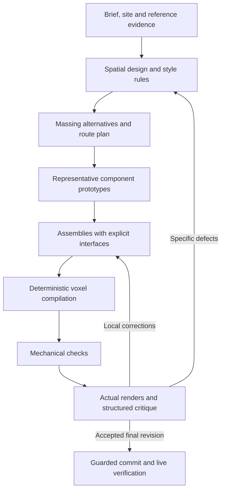

# Voxel Build: architectural quality design

Status: implementation proposal, grounded in the existing engine and the completed small castle. This document does not add the proposed capabilities to the running app. Scope is a local tool used by this Codex agent, with no additional model or paid inference service.

## 1. Outcome and limits

Produce intentionally composed, detailed, usable Minecraft builds with traceable construction and evidence of inspection. Support multiple architectural styles and explicit reference matching. Reduce repeat work through reliable components and local corrections, while retaining the time needed to design and judge the result.

“Almost perfect for any structure” cannot be guaranteed by a skill or compiler. Correct voxel coordinates do not establish that a tower is beautiful, a roof belongs to a style, or a speculative rear elevation matches an unseen reference. Separate objectively enforceable constraints from architectural judgment. Require evidence for both; do not invent a universal aesthetic score or claim zero semantic mistakes.

## 2. What failed in the castle

Inspected `builds/small-castle/generate.cjs`, its review, and revision 2 contact sheet.

| Observed result | Cause in current workflow | Required change |
| --- | --- | --- |
| Broad, nearly single-plane stone walls | Generator starts with a hollow box; depth is left to discretionary decoration | Design wall sections, bays, corners and transitions before repeating a wall |
| Identical slender towers, tiny windows | Repeated five-block shells with no developed tower prototype | Set usable internal dimensions, openings, floor access and silhouette before instancing |
| Heavy stepped roof and abrupt wall junctions | Roof is a stack of fills, with no explicit eave/ridge/junction model | Use roof assemblies with pitch, edge treatment, interfaces and interior clearance |
| Towers have no access; lights lack explicit attachment contracts | Occupancy and functionality were not specified per component | Route graph, collision-aware traversal, attachment requirements |
| Courtyard mostly empty; four moss cells stand in for landscaping | No courtyard use or composition plan | Give negative space a purpose, a route and a deliberate edge treatment |
| Small castle in a large terrain screenshot | Render framing follows capture bounds | Frame the structure and furnish separate close-ups and player-eye views |
| Generic review accepted all this | Review currently checks view names, missing resources, audit failures and a minimum text length | Structured evidence and defect resolution, with architectural evaluation still performed by the agent |
| Added approach exists in the plan but not the generator source | Manual JSON edit bypassed source regeneration | One maintained source for all authored features; regeneration equality check |

The earlier speed work remains useful. It does not fix these design and evaluation failures by itself.

## 3. Architecture: semantic design before voxel compilation

The same agent designs, critiques and repairs. Separate passes provide different inspection tasks, not independent expert validation. The local engine handles repetitive geometry, measurement, contracts and rendering; it does not contain an architectural AI.

### 3.1 Design specification

Add a versioned `design.json` above the existing plans. Record:

- Site bounds, terrain response, protected areas, block scale, footprint and intended player uses.
- Named masses and their relationships: keep dominates gatehouse, roof covers hall, stair connects courtyard to parapet.
- A style description with examples of supported motifs and incompatible combinations. Modern architecture may intentionally use quiet flat planes; gothic facade rules must not leak into every style.
- Palette roles: load-bearing base, masonry, timber, roof, metal, glazing, accents and context-sensitive weathering.
- Openings, circulation, roof/support strategy, required room functions and deliberate empty space.
- User-approved features and the regions pinned to preserve them.
- References, observed features, inferred features and unresolved uncertainty.

Example relationship: `stair-east` connects `courtyard.floor` to `east-wall.walk`; its landing sockets must meet both surfaces, and its reserved clearance volume cannot be occupied by another component. Named relationships survive a footprint or height change.

Compile this layer into the existing bounded declarative plan format. Preserve canonical block states, current district boundaries, checkpoints, CAS, receipts and recovery. Add the semantic layer without replacing working transaction protection.

### 3.2 Components as small architectural assemblies

Prioritize wall bay, window reveal, corner, buttress, pointed/round opening, gate assembly, stair/landing, wall walk, tower floor, eave, ridge, gable and roof intersection.

Each component declares its parameters, local origin/orientation, occupied and reserved volumes, palette roles, attachment/landing sockets, permitted overlaps, visibility and inspection cameras. Include normal, end, corner and narrow-width variants. Reject a requested width that cannot fit the functional requirements; offer a different assembly rather than silently compressing away the detail or stair.

A component is accepted only after its real blocks have been rendered from relevant angles and its interfaces exercised. Save the reviewed parameter ranges and defects found. “Reviewed at width seven” does not certify width three or every roof intersection. Do not market generated examples as professional-builder-authored assets.

### 3.3 Block provenance and explicit overlap rules

During compilation associate authored cells with component, operation, semantic role and revision. Track bounding regions cheaply and keep detailed provenance on disk, outside agent context.

Default cross-component overlap is an error. Explicit operations may replace only designated owners/roles within declared regions: an opening may cut its wall, a roof valley may trim its roof skins, a foundation may replace surveyed natural terrain. Compatible shared masonry can be declared. Door clearance, protected terrain, pins and foreign edits remain protected.

Material changes must follow authored regions or features: damp base, worn passage, damaged corner, roof edge. A deterministic random scatter is still random-looking. No automatic noise pass. Intentional texture variations remain permitted when their placement has a coherent visual rationale.

Provenance catches accidental cross-component writes and explains repairs. It cannot determine that an intentionally authored decorative block is aesthetically misplaced. That remains an inspection question.

### 3.4 Deterministic shape and state rules

Prefer local assembly parameters over long freehand voxel lists. Establish integer origins, parity, bay rhythm and symmetry intent before generating. Use explicit exceptions for ruins and intentional asymmetry.

Generate stairs, slabs, doors, walls, fences and panes with valid orientation and connection states. State normalization uses the actual Minecraft registry. Attachment rules cover lanterns, doors and hanging pieces. Decorative floating objects require an explicit exception rather than automatic deletion.

Changed parameter -> regenerate owning components and dependents -> clear obsolete owned cells -> compile delta -> audit -> inspect affected interfaces. Preserve approved unrelated features. Keep source, output and revision hashes together so a later regeneration cannot lose manual improvements.

## 4. Planning that produces depth and coherent detail

### 4.1 Composition before ornament

For an ambiguous or complex brief, compare a small number of genuinely different massings using the same scale, palette and cameras. For a clear supplied design, follow it directly. Do not generate alternatives as a ritual for every request.

Select based on the requested silhouette, entrance hierarchy, dominant/subordinate volumes, roof relationships, negative space and terrain connection. Review a neutral material render to expose shape problems that texture can disguise.

### 4.2 Facade sections and prototypes

Create a representative facade bay with a cross-section before repeating it: foundation/plinth, main wall plane, recessed opening, trim/support projection, top termination and roof/walkway interface. Depth is a design variable, not a quota of trapdoors.

For a masonry castle, an illustrative section could use a main face at depth zero, glazing recessed one block, a buttress projecting one block and a cornice spanning the transition. Its actual dimensions depend on footprint, style and opening scale. Avoid universal “minimum three layers everywhere” checks: a valid quiet surface should not acquire meaningless clutter to satisfy a metric.

Prototype the corner and gate separately; they have different responsibilities from a repeated wall bay. Inspect the actual close-up. Then instance compatible variants along planned bays with intentional termination at corners and changes in height.

### 4.3 Interior and exterior are one design

Reserve stairs, floor thickness, landing clearances and doors before finalizing the facade. Align windows with floors and rooms. Mark accessible spaces and intentionally inaccessible decorative masses explicitly. A tower presented as usable needs a demonstrated route; do not quietly downgrade it after construction.

For a tight “small but detailed” castle, fewer well-developed masses can outperform four tiny towers. Consider a gatehouse, one stronger keep, compact courtyard and accessible wall walk before forcing four copies into the available area. Small means a compact footprint, not omitted joins, inaccessible rooms or unfinished backs.

## 5. Reference fidelity

Use the image the user provided. Record image dimensions, the region actually depicting the build, foreground occlusion, likely perspective and distinctive landmarks. Identify roof peaks, eaves, tower centers, major openings, base line and principal silhouette. Record normalized coordinates/ratios and which observations are uncertain. No fabricated hidden elevations.

Calibrate a matching render camera by adjusting position, target and field of view. A viewpoint mismatch is not automatically a geometry error. Show reference and actual render side by side; add optional manually annotated landmark/silhouette overlays with the original preserved. Color comparisons must account for lighting and texture differences. Use actual block samples when selecting a palette.

Compare in order: silhouette and proportions, mass placement, opening rhythm, depth/junctions, material roles, then signature details. For the earlier arena, additional spires cannot compensate for a wrong platform-to-outer-ring ratio or weak guardian silhouettes.

Landmark reprojection error and silhouette overlap can be useful diagnostics only for compatible views and valid annotations. They do not certify beauty or complete reconstruction from one image. No runtime paid vision API or second model is required: this agent annotates and evaluates, local tools measure and render.

## 6. Validation and review

### 6.1 Enforceable checks

| Check | Implementation | Important limit |
| --- | --- | --- |
| Bounds, states and protected changes | Existing compiler/registry/CAS plus ownership contracts | Cannot judge design intent |
| Unexpected overlaps, cuts and missing seams | Component volumes, sockets, overlap declarations | Intentional shared geometry needs an explicit rule |
| Clear doors and passage connections | Reserved volumes and route endpoints | Occupied/non-air is not collision geometry |
| Reachability, stairs and headroom | Player collision-shape traversal at declared player dimensions | Needs actual collision data; meshes alone are insufficient |
| Floating details and attachments | Connected components plus block-specific attachment contracts | Floating islands and hanging chains can be intentional |
| Open roofs, invalid joins and missing end caps | Assembly-specific interface tests and section checks | Not a universal voxel heuristic |
| Unintended symmetry changes | Compare declared symmetric component pairs | Preserve intentional asymmetric design |
| Regressed approved feature | Existing exact region pins | Narrow pins must not freeze unrelated refinement |
| Source/output divergence | Rebuild generated plans and compare canonical maps/hashes | Stable hashes cannot establish aesthetic quality |

Do not claim full movement simulation until block collision data is supplied and validated. Start with declared clearances and conservative known full-block cases; report unsupported shapes. Preserve the existing game application safeguards throughout.

### 6.2 Render evidence

Add explicit render presets for structure framing, four elevations, aerial/top, player-eye approach, interior and section cuts. Capture bounds and review framing are separate concepts. A tiny building in a huge terrain contact sheet is insufficient detail evidence.

Add neutral shape, material and depth/normal views. Actual depth buffers or geometry-derived diagnostics are preferable to inferring physical recesses from RGB shadows. Upgrade lighting for legibility, but do not use dramatic illumination to disguise geometry problems. Retain a plain daylight pass.

For each defect, record component/location, screenshot, observed symptom, intended correction, affected dependencies and verification image. Reject unresolved major defects. Match evidence hashes to the exact geometry, camera and revision; parameter changes invalidate dependent reviews.

Replace the single generic review note with structured findings covering composition, detail/junctions, functionality and reference fidelity when applicable. The engine can require evidence, unresolved-defect status and matching hashes. It cannot verify that written praise is truthful. The agent must inspect and critique honestly; external user evaluation remains necessary to establish perceived quality.

### 6.3 Completion criteria

Deliver when the requested features are present, declared functional routes pass, known unintended placements/conflicts are resolved, final relevant views have been inspected, and live verification succeeds. Recheck changes after relevant world ticks. Explain genuine limitations specifically.

If geometry or navigation cannot fit the requested footprint, change the design within scope or resolve that tradeoff. Never label a failed check a success, silently accept blocked spaces, or recapture to conceal foreign edits. Address expected grass-to-dirt transitions as documented state changes; do not discard arbitrary mismatches as physics.

## 7. Efficiency without shallow construction

- Cache accepted component geometry by parameters, palette, transform and library version; invalidate dependencies when interfaces change.
- Reuse existing mesh/snapshot caches, exact local generators, atomic source-checkpoint staging and coordinated manifests.
- Regenerate affected components; use conservative seam/neighbor invalidation. Finish with a coherent whole-build review.
- Batch local measurements and return bounded defect summaries, evidence paths and patches. Never send the whole voxel map back to the agent.
- Preserve a compact design/defect state between turns. Avoid repeatedly reading code and reinterpreting references.
- Use lightweight previews for massing selection and readable final/cropped images for detail. Do not lower geometry quality to save rendering time.
- Record total elapsed task time, active engine times, iteration counts, user corrections and any available agent-usage data. Mark unavailable usage as unknown; do not infer token cost from milliseconds.

Speed and quality are measured together. Faster acceptance of a poor castle is a regression even when all engine timings improve.

## 8. Implementation order and acceptance evidence

| Phase | Changes | Exit evidence |
| --- | --- | --- |
| A. Review discipline and framing | Structured design/defect records, building-focused camera presets, close-up/section requirements, source consistency; skill links to actual capabilities | The existing castle is correctly identified as needing redesign; no generic note can substitute for the missing required evidence |
| B. Semantic compiler | Design schema, named components, sockets, ownership, reserved space, scoped replacements, dependency invalidation | Injected cross-component overwrite, missing landing, stale dependency and ghost block are detected; exact existing CAS/recovery tests still pass |
| C. Architectural library | Masonry wall/window/corner/gate/stair/roof assemblies; cottage timber/roof assemblies; parameter/interface fixtures | Real model renders and mechanical tests across approved dimensions/rotations, including ends and intersections; rejected unsupported dimensions |
| D. Reference workspace | Reference annotations, saved matching cameras, side-by-side comparisons, landmark diagnostics | A deliberately altered roof height/tower spacing is exposed; camera changes do not produce false geometry claims; original image preserved |
| E. Movement and finish | Collision-aware traversal, attachment/state rules, roof/interior checks, conservative physics handling | Reachable furnished keep and wall walk; broken stair headroom and unsupported lantern fixtures detected; live tests in isolated worlds |
| F. Quality evaluation | Varied held-out tasks, full task timings and user-facing comparisons | Demonstrated improvement on unseen builds, with remaining weaknesses recorded |

Implement A through C first. They address the observed failure directly. More block-entity support and elaborate lighting are useful later but will not rescue weak proportions or shallow facades. Start reference annotation/camera work early when the task supplies images.

Suggested module boundaries: `builder/design/` for schema/compiler/provenance; `builder/components/` for assemblies and contracts; `builder/quality/` for diagnostic and route checks; `builder/reference/` for annotations/comparison artifacts. Extend `workflow.mjs`, `server.mjs`, `renderer.ts` and the maintained skill progressively. These paths are proposed, not already available commands or modules.

Legacy plans continue to work as low-level imports but cannot claim the new architectural checks without metadata. New detailed building tasks use the semantic path once implemented. Do not hard-reject intentionally minimalist buildings on a flatness heuristic.

## 9. How to prove it works

Use a small masonry castle, timber cottage, stone townhouse, modern house and complex roofed hall, plus an organic sculpture to test the limits of architectural components. Include both reference-driven and text-only requests. Keep some reference/task variations out of component development so evaluation does not merely repeat a memorized example.

Render old/new results with equivalent viewpoints, framing and plain lighting. Judge silhouette, proportions, depth, joins, reference fidelity, usable spaces and coherent details separately. Ask the user to compare anonymized outputs when practical, without requiring approval at every build stage. Their evaluation validates visual preference; mechanical tests validate reproducible correctness.

Record recurring defects and repair cost. Measure total time and available usage alongside quality, with consistent model/settings and clearly stated task scope. A single attractive example, passing unit tests or a higher detail count is insufficient evidence for broad professional quality.

The first concrete evaluation should replace the small castle in an isolated draft with a more considered compact design, then compare it with the current castle before any authorized world replacement. The planning request alone does not authorize demolishing the current build.
